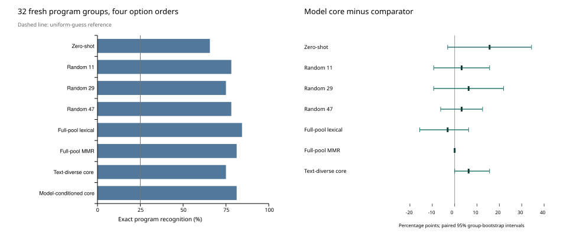

# Demonstration selection and reliable Qwen reasoning

I study how local language models use demonstrations, translate questions into programs and respond to verification. The latest study follows Mengyue Yang and colleagues’ [FEEDER paper](https://proceedings.mlr.press/v267/jin25i.html), with frozen cases, eight context conditions, option-order controls and independent replay.

On **32 fresh synthetic four-choice program questions**, averaging four answer orders improved exact recognition with the same lexical-retrieved demonstrations from **17/32 to 27/32**. This uses **four scoring calls instead of one**. The model-conditioned preselected pool scored **26/32 versus 27/32** for full-pool retrieval, so its improvement gate failed. No better selector or general reasoning breakthrough is claimed.

[Full report and limitations](demo-selection/REPORT.md) · [Frozen protocol](demo-selection/FOLLOWUP_PROTOCOL.md) · [Results](demo-selection/followup_results.json) · [Independent auditor](demo-selection/followup_audit.py)



The earlier all-A readout, the corrected follow-up, failed selection gates and fragile coverage witnesses are all retained. Runs used one installed Qwen3-1.7B four-bit model at a time, with **1.51 GiB maximum observed MLX allocation** across the recorded phases and diagnostic. No weights or datasets were downloaded. The repository includes synthetic questions, raw label scores and costs, rather than model weights.

## Earlier recurrent-adapter audit

**Follow-up.** [One counterfactual separates 2,401 reasoning programs](counterfactual/REPORT.md). The follow-up proves and exhaustively checks when a single answer can certify a bounded program, then tests translation and review with fresh local Qwen inference.

An answer-key oracle could solve **13 of 64 GSM8K problems** by choosing the correct answer from any of three archived Qwen3-1.7B adapter runs. The stock Qwen run solved **40 of 64**. Giving the original one-pass adapter a second try at three refinements rescued just **one** of its 54 misses, even with perfect routing and answer selection. This limits what inference-time routing can do with this fixed set of proposals. [Protocol](PROTOCOL.md) · [Results](results.json)

## Same questions, different routes

| Policy | Human-written GSM8K | Generated linear algebra |
|---|---:|---:|
| Stock Qwen, worked-solution prompt | 40/64 | 17/24 |
| One pass, 1,200 training microsteps | 10/64 | 18/24 |
| Three recurrent refinements, 1,200 microsteps | 8/64 | 20/24 |
| One pass, 3,600 microsteps | 10/64 | 16/24 |
| Oracle choosing among the three adapters | **13/64** | **20/24** |
| Oracle choosing between one pass and stock Qwen | 41/64 | 23/24 |

The equal-microstep recurrent adapter fixed one word problem and broke three compared with the one-pass adapter. The exact paired test gives p = 0.625. The longer one-pass control roughly matches trainable-tail block evaluations during training, with more updates and checkpoint opportunities. Stock Qwen used a different answer format. These are comparisons of archived policies on the same finite cases. They do not isolate a unique architectural cause.

## What a perfect router could achieve

After one pass on every question, let a router request one extra candidate for at most `k` questions and keep the original candidate if it wishes. If the original solves `B` questions and the allowed second candidates can solve `R` distinct misses, the oracle's maximum is `B + min(k, R)`. No routed request can recover two misses, and allocating to any `min(k, R)` of the recoverable misses attains the bound. Independent exhaustive enumeration checks the formula on a small fixture. The cost unit is an extra candidate call. The model calls may differ in latency or FLOPs.

| Extra candidate calls on the 64 word problems | 0 | 1 | 2 | 4 | 8 | Unlimited |
|---|---:|---:|---:|---:|---:|---:|
| Three refinements only | 10 | 11 | 11 | 11 | 11 | 11 |
| Either trained adapter alternative | 10 | 11 | 12 | 13 | 13 | 13 |
| Stock Qwen fallback | 10 | 11 | 12 | 14 | 18 | 41 |

The recurrent adapter's exact checker accepted **54/64** emitted derivations, of which **46** still gave the wrong reference answer. The checker validates a derivation conditional on the proposed program. The figures establish that this check alone cannot establish answer correctness. They motivate assessing how the problem is translated into a program, before spending more compute on the deduction.

The audit reuses an inspected 88-question fixture and frozen archived runs from one adapter training seed. It adds no fresh model inference and gives no population accuracy estimate. A stronger follow-up would freeze a larger, independently sampled word-problem suite, compare question-to-program choices across equivalent rephrasings, and measure the cost of selecting or rejecting competing parses.

## Reproduce

The public replay uses a compact table of booleans without question text or generated answers. The optional archive-backed replay hashes the four original files, checks identifiers and gold targets across arms, and re-scores answers with exact rational arithmetic.

```sh
python3 audit.py --table case_table.json --verify results.json
python3 audit.py --archives /path/to/loop-transformer/results --table case_table.json --verify results.json
```

[Training and typed-program source](training/README.md) contains the original recurrent model, LoRA pipeline and exact arithmetic interpreter.
